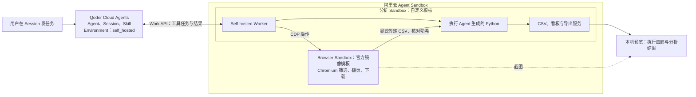

# Qoder × Agent Sandbox Live Demo

支持账号资源自动准备：提供阿里云凭证、地域和独立 Qoder 授权后，选择复用或新建云资源。
使用路径及验证范围见[账号资源自动准备](docs/bootstrap.md)；历史云端实测不代表自动准备流程已完成空白账号实测。

这个仓库用于跑通和演示 **Qoder × 阿里云 Agent Sandbox 的 Live Demo**：在 Qoder 发起任务，由阿里云 Sandbox 执行浏览器操作和 Python 分析，再把真实结果交给用户。

演示载体是一个**交互式报表分析 Agent**，用三轮对话串起完整过程：

1. 下载报表：操作浏览器筛选、翻页、下载 CSV，分析后生成看板和文件。
2. 连续追问：沿用已下载文件，排除金额最高的分类，重新计算。
3. 现场追加：增加一条记录，更新看板及 CSV、Excel、JSON、离线 HTML。

Qoder 负责 Agent 决策，两个 Sandbox 分别负责浏览器和分析执行。本地终端用于准备资源、发送或观察任务、独立验收；本机浏览器展示云端执行画面和分析结果。

首次体验建议使用下面的交互向导；需要逐条执行时，可继续阅读手动步骤。详细的 Qoder 页面操作和演示节奏见[实操指引](docs/live-demo.md)，历史实测见[验证记录](docs/validation.md)。

## 一、一条命令开始

在项目根目录运行：

```bash
./start.sh
```

只想先看步骤与逻辑，可运行 `./start.sh --preview`，不安装依赖、不连接账号、不创建资源。每一步按“目的 → 执行路径 → 将得到什么”呈现，完成后显示实际结果。安装、构建与创建过程显示真实阶段和耗时，详细输出保存在 `var/logs/`；发生错误时显示关键原因与日志位置。

向导按六个阶段推进，每个阶段说明作用、执行命令和成功反馈：

1. **安装依赖**：检查 Python，创建或复用 `.venv`，安装演示和构建依赖。看到安装完成、命令可用的提示后继续。
2. **账号资源准备**：输入阿里云 AK/SK、region 和独立 Qoder PAT（STS 另需 Token）；自动查询 Team、ACR、交换机和安全组，选择复用或新建。每次写操作说明具体影响并确认；ACR 购买需额外确认规格、周期、费用条款。自动保存配置和资源归属记录。
3. **准备模板**：检查 Docker 与镜像拉取网络，自动创建缺失的指定 ACR 命名空间和私有仓库。确认模板在云端仍就绪且匹配当前代码后复用，否则构建并等待就绪。
4. **创建资源**：创建或接续本轮 Qoder 资源、两个 Sandbox 和 Worker，启动本机预览，打开 Qoder Session 与双栏演示页。
5. **三轮演示**：逐轮发送任务或观察页面已发的任务，显示工具动作、验收结果、行数和金额。每轮可停下查看页面；已提交或已通过的轮次不会重复发送。
   每轮先展示当前配置中的完整消息（青色）与默认预期（黄色），再按序展示工具调度，最后显示实际数字、文件核验与结论（通过为绿色，失败为红色）。颜色仅用于区分内容，普通终端仍可阅读全部文字。三轮通过后可继续在 Qoder 自由问答；收尾展示已通过的三轮快照与当前看板差异，不用默认固定数据重新判定自由问答的结果。显式执行 `verify --phase append` 仍按默认第三轮的严格规则验收。
6. **验收回收**：重新核对实际文件，下载所需结果，再选择回收本轮运行或保留云端环境。

安装时显示 pip 的真实阶段和活动条，不估算百分比；完整日志保存在 `var/logs/install.log`，失败时显示末尾错误。每个配置字段提供简例和官方配置地址；输入 `?` 查看获取方式，输入 `open` 直接打开对应页面，再回到当前字段填写。本地输入内容可见，已有凭证仅提示“已配置”，回车可保留。

不需要手动激活虚拟环境。向导发现已有未回收运行时，会先让你继续该轮或先回收，不直接覆盖它的连接配置；网络或权限错误会停在当前阶段。若已有模板仍在构建，向导保留原 ID 并提示稍后重跑，不重复提交。

`Ctrl+C` 会停止向导及其启动的本机预览，保留已保存的配置和运行记录。重跑 `./start.sh` 可检查并接续这些进度。模板构建提交后应等待返回 ID；若在 Browser 模板返回 ID 前强制中断，先在控制台核对是否已创建，再决定是否重建。

结束时输入 `cleanup` 回收本轮 Qoder 与 Sandbox，模板、ACR 镜像和本地结果保留；输入 `keep` 保留云端运行并退出，或输入 `view` 继续查看。准备阶段仅在明确批准后新增 VPC 绑定和公网访问配置；不放宽已有安全组。

需要卸载本项目创建的准备资源时，先运行 Demo `cleanup`，再执行 `.venv/bin/python scripts/bootstrap.py --uninstall`。复用资源保留；购买的 ACR、OSS 和共享服务角色不自动退订或删除，终端会列出保留项。不要先删除 `var/state/`。

只查看向导说明：

```bash
./start.sh --help
```

## 二、手动分步操作

首次运行依次完成第 1–8 步。后续演示可复用已就绪的模板，从第 4 步开始；修改 `src/` 或分析镜像内容后，先重建分析模板。

### 1. 安装依赖，确认命令可用

准备 Python 3.11+、已启动的 Docker 和 Buildx。还需要 Qoder 国际站 PAT、阿里云杭州 Agent Sandbox Team API Key，以及可推送和拉取镜像的杭州 ACR 企业版仓库。阿里云 AK 用于创建自定义模板。

将仓库克隆或解压到本机，终端进入包含 `pyproject.toml` 的项目根目录，执行：

```bash
python3 --version
docker version
docker buildx version
python3 -m venv .venv
source .venv/bin/activate
python -m pip install -e ".[demo,build]"
qoder-self-hosted-sandboxes-demo --help
```

**看到什么：**帮助页列出 `setup`、`templates`、`task`、`preview`、`cleanup` 等命令，说明本地安装和命令注册成功。

**关注什么：**`demo` 安装演示依赖，`build` 安装模板构建依赖。所有命令均在项目根目录执行；新开终端后先激活 `.venv`。`docker version` 应能看到 Server 信息。

### 2. 填写连接配置，检查 Qoder 访问

先复制配置示例；已有配置时保留原文件，`cp -n` 不会覆盖：

```bash
cp -n config/.env.example config/.env
cp -n config/.env.cloud.example config/.env.cloud
cp -n config/registry.example.toml config/registry.toml
chmod 600 config/.env config/.env.cloud
```

打开 `config/.env`，填写 Qoder PAT 和 Sandbox Key。杭州连接地址已提供：

```dotenv
QODER_ACCESS_TOKEN=<Qoder 国际站 PAT>
E2B_API_KEY=<阿里云 Sandbox Team API Key>
E2B_API_URL=https://api.cn-hangzhou.sandbox.aliyuncs.com
E2B_DOMAIN=cn-hangzhou.sandbox.aliyuncs.com
```

打开 `config/.env.cloud`，填写有模板创建权限的阿里云凭证；临时凭证还需填写 Security Token：

```dotenv
ALIBABA_CLOUD_ACCESS_KEY_ID=<阿里云 AK ID>
ALIBABA_CLOUD_ACCESS_KEY_SECRET=<阿里云 AK Secret>
ALIBABA_CLOUD_SECURITY_TOKEN=
```

打开 `config/registry.toml`，填写实际仓库与资源参数：

```toml
repository="<实例名>-registry.cn-hangzhou.cr.aliyuncs.com/sandboxhub/qoder-self-hosted-sandboxes-demo"
instance_id="<ACR 实例 ID>"
vpc_id="<VPC ID>"
vswitch_id="<vSwitch ID>"
security_group_id="<安全组 ID>"
region="cn-hangzhou"
team_id="<与 E2B_API_KEY 对应的 Sandbox Team ID>"
```

在 ACR 中创建 `sandboxhub` 命名空间和 `qoder-self-hosted-sandboxes-demo` 私有仓库，或将 `repository` 改为已有仓库。按 ACR 控制台给出的命令完成 Docker 登录；已有登录可直接复用。还需在 ACR 实例的“访问控制 → 专有网络”绑定上面的 VPC，等待绑定状态为 `RUNNING`。

```bash
qoder-self-hosted-sandboxes-demo doctor
```

**看到什么：**终端输出 `doctor_pass` 和 `qoder_models`，说明配置能够读取，Qoder 模型列表接口可访问。

**关注什么：**这里的 `E2B_API_KEY` 填阿里云 Key，不能填 E2B Cloud Key；`team_id` 要与它对应。VPC 三项参数用于 ACR 镜像拉取，不配置运行实例的 VPC。`doctor` 尚未验证 Sandbox Key、AK 权限和 ACR 拉取路径，后续构建与创建步骤会分别验证。

需要脚本自动登录 ACR 时，才复制 `config/.env.registry.example` 为 `config/.env.registry`，填写 `ACR_USERNAME` 和 `ACR_PASSWORD`。密码是镜像仓库登录密码或临时 Token。完整字段说明见[配置连接](docs/live-demo.md#2-配置连接)。

### 3. 准备 Browser 与分析模板

这一步把两个执行环境准备好，后续创建实例直接使用模板：

```bash
qoder-self-hosted-sandboxes-demo templates browser
qoder-self-hosted-sandboxes-demo templates analysis
```

第一条基于官方 Browser 镜像创建模板。第二条构建包含 Worker、Python 分析依赖和网页服务的自定义镜像，推送 ACR，再创建分析模板并等待就绪。

**看到什么：**Browser 输出模板 ID；分析模板状态最终为 `ready`。模板信息写入 `var/state/templates.json`，在阿里云控制台的“沙箱模板”中可查看对应资源。

**关注什么：**首次构建需要等待，不计入现场 10 分钟演示。两个构建命令每次都会创建新模板，不会直接采用可能过期的本地 ID；已有就绪模板时无需在每次演示前重复构建。修改 Browser 模板配置后重新构建 Browser，修改分析源码或镜像内容后重新构建分析模板。镜像、规格、启动与就绪命令在 `config/templates.toml` 中配置。

推送遇到 `broken pipe`、连接重置或超时时，会自动重试同一镜像，最多 3 次；已上传的镜像层可复用。登录、权限和证书错误直接停止。持续断连时检查 Docker Desktop 的网络、代理或 VPN，再重跑 `./start.sh`，不要删除 `var/state/`。低带宽网络可参考 [Docker 推送说明](https://docs.docker.com/reference/cli/docker/image/push/#concurrent-uploads)调整上传并发；向导不会自动修改全局 Docker 设置。

### 4. 创建资源，取得本次 Session 和 Sandbox ID

```bash
qoder-self-hosted-sandboxes-demo setup
qoder-self-hosted-sandboxes-demo status
```

`setup` 创建两个 Sandbox，核对分析镜像中的源码和服务，上传 Skill，创建 Qoder Agent、Self-hosted Environment 与 Session，并在分析 Sandbox 内启动 Worker。

**看到什么：**先输出 `sandboxes_created`，其中 `analysis_create_ms` 是本次分析实例创建请求耗时；随后输出 `setup_ready`，包含 `session_url`、`preview_url` 和两个不同的 Sandbox ID。在 Qoder 查看本次 Agent、Environment、Skill、Session，在阿里云杭州控制台对应 Team 查看两个实例。

**关注什么：**后续任务都使用这次生成的 Session。`status` 显示本地运行记录，不实时确认云端实例仍存活。默认实例有效期为 3600 秒，配置在 `config/app.toml`；已有未回收资源时，程序会拒绝重复 `setup`。单次创建耗时包含客户端网络，不作为服务端启动 SLA。

### 5. 打开预览，准备观察执行过程

另开一个终端，进入同一项目目录并执行：

```bash
source .venv/bin/activate
qoder-self-hosted-sandboxes-demo preview
```

**看到什么：**输出 `Preview ready: http://127.0.0.1:8765`。打开[本机演示入口](http://127.0.0.1:8765)，宽屏左侧展示浏览器画面与文件传递证据，右侧展示分析看板；窄屏可切换“浏览器现场 / 分析结果”，默认先看结果。通过“打开 Qoder 会话”进入本次 Session，使用创建它的 Qoder 账号登录。

页面顶部的三轮任务按钮用于复制对应提示词，复制后到 Qoder 粘贴发送，再用终端 `observe` 验收；它不会替你发送任务。文件就绪后才开放下载，会话或实例结束后入口会自动禁用。安装新版本后若发现已有运行源码不一致，先回收旧运行再重建，避免看到旧界面。

两个面板顶部分别显示完整 Sandbox ID，可一键复制。执行摘要来自实际 Worker 工具记录：网页采集侧展示筛选条件、CSV 下载和传递结果；报表分析侧展示 Python 执行状态、输入与输出摘要。展开可查看当轮真实代码、标准输出和动作历史，以及对应的模板 ID、模板名称、镜像；未发生的动作不会显示为已执行。

两个沙箱使用不同镜像。Browser 使用官方 Chromium 镜像；Analysis 使用 `images/report_analyst/Dockerfile` 构建的 Python 分析镜像，预装 pandas、Plotly、Excel 导出工具与 Worker。新模板分别命名为 `qoder-sandbox-csv-browser-<时间戳>`（网页采集）和 `qoder-sandbox-py-analysis-<时间戳>`（报表分析），在 `config/templates.toml` 中配置，名称不超过[控制台规定的 36 字符](https://help.aliyun.com/zh/agent-sandbox/console-management-custom-templates)。实例创建时绑定各自模板。旧运行未记录的镜像信息显示“未记录”，不会套用当前配置冒充历史信息。

**关注什么：**保持这个终端运行，在原终端执行后续命令。首次任务前，看板尚无分析结果、浏览器画面仍在等待，均属正常。若提示端口占用，先在旧预览终端按 `Ctrl+C`，或调整 `config/demo.toml` 中的 `preview_port` 后重试。网页和数据服务运行在云端，本机只提供鉴权代理与截图预览。

### 6. 依次执行三轮任务，逐轮核对反馈

第一次跑通可在原终端执行以下命令。`task` 会把 `config/demo.toml` 中的提示词发送到 Qoder，等待 Agent 完成本轮后自动验收；同时可在 Qoder Session 查看对话和工具调用。**每轮验收通过后，再执行下一轮。**

#### 第一轮：下载报表并分析

```bash
qoder-self-hosted-sandboxes-demo task --phase collect
```

Agent 筛选 2026 年 10 月、华东地区数据，操作浏览器翻页并下载 CSV，传到分析 Sandbox，生成并执行 Python，发布看板与导出文件。

**看到什么：**左侧发生筛选、翻页和下载，文件证据显示两端 SHA-256 一致；右侧出现分类和趋势图。默认数据为 **100 行、金额合计 45,392.18**。

**关注什么：**终端 `verification` 的 `phase` 为 `collect`，`checks` 全部为 `true`。本轮结果保存在 `var/results/<run_id>/collect-verification.json`，用真实文件独立核算，不能只看 Agent 的文字答复。

#### 第二轮：连续追问，改变统计范围

```bash
qoder-self-hosted-sandboxes-demo task --phase revise
```

Agent 沿用已下载的数据，排除金额最高的分类，再次生成分析代码，更新看板和导出文件。

**看到什么：**排除“计算”分类，剩余 **65 行、金额合计 28,508.77**，看板版本增加。

**关注什么：**本轮 `verification` 全部通过，`input.csv` 哈希不变，仍使用同一 Session 和两个实例。变化来自重新计算统计范围，原始记录没有被删除。

#### 第三轮：追加记录，更新全部产物

```bash
qoder-self-hosted-sandboxes-demo task --phase append
```

Agent 恢复全部分类，在工作副本中追加一条“现场演示”、金额 6,666 的记录，重新计算并更新文件。

**看到什么：**看板显示 **101 条数据、金额合计 52,058.18**；Excel 含表头共 102 行，新增的 6,666 位于第 102 行。看板新增“现场演示”分类；验收通过后，终端输出 `LIVE_PASS`，本地生成 `var/results/<run_id>/LIVE_PASS.json`。

**关注什么：**相较第一轮只增加一条记录、金额只增加 6,666，源报表不变。点击看板下载 CSV、Excel、JSON 和离线 HTML，核对新增记录；需要保留的文件应在回收实例前下载。上面的数值对应默认合成数据和提示词，修改场景后需同步调整验收条件。

**现场改用 Qoder 页面发任务：**按[实操指引](docs/live-demo.md)逐轮发送提示词，并把对应的 `task --phase ...` 改成 `observe --phase ...`。`observe` 只观察并验收页面刚发的任务；同一轮二选一，避免重复发送。任务超时后用 `resume` 接续，不重复提交追加记录。

### 7. 核对本次执行结果

```bash
qoder-self-hosted-sandboxes-demo status
qoder-self-hosted-sandboxes-demo verify --phase append
```

`verify` 重新读取云端文件与执行记录，核对实例身份、CSV、Excel、JSON、HTML、文件哈希和统计结果，不会再发任务。

**看到什么：**追加轮 `verification` 的检查项全部为 `true`。本地 `var/results/<run_id>/` 中保存各轮事件、验收 JSON、实际分析代码，以及 Excel 和浏览器截图；完整导出文件可从看板下载。

**关注什么：**预览页、文件证据和控制台中的 Sandbox ID 应一致。`verify` 适用于已结束的轮次，不能用来等待任务完成；重新验收依赖实例仍可访问。

### 8. 回收本次演示资源

确认文件已下载，在预览终端按 `Ctrl+C` 停止本机预览，再在原终端执行：

```bash
qoder-self-hosted-sandboxes-demo cleanup
```

**看到什么：**输出 `cleanup_pass`。两个 Sandbox 已释放；本次 Qoder Session、Agent、Environment 已归档，Skill 已删除。

**关注什么：**镜像、模板、本地配置和 `var/` 记录保留。下次从第 4 步重新创建资源；历史结果按 `run_id` 分目录保存。不要先删除运行记录再回收，否则会丢失本次资源的对应关系。

常见异常的处理见[排障与回收](docs/live-demo.md#11-排障与回收)。凭证及运行记录不提交，见 [SECURITY.md](SECURITY.md)。

## 三、架构与请求流程



**Qoder 的资源关系：**Agent 定义模型、指令、工具和绑定的 Skill；Session 选择 Agent 与 Environment，承载对话与事件。分析 Sandbox 中的 Worker 承接一个 `self_hosted` Environment；Browser Sandbox 是独立工具实例，不另注册为 Qoder Environment。

一次请求按以下顺序处理：

1. 用户在 Qoder Session 发消息，或由本地 `task` 命令通过 API 发送。
2. Qoder 结合指令、Skill 与会话上下文，决定调用什么工具。
3. Worker 通过 Work API 领取工作、维持心跳，读取工具事件并执行。
4. 采集工具通过 CDP 操作 Browser Sandbox；下载的 CSV 显式传到分析 Sandbox，核对两端哈希。两个实例不共享文件系统。
5. 分析工具执行 Qoder 当轮生成的 Python，核对结果后发布看板、导出文件；Worker 将实际结果回传 Qoder，供其继续决策或回复。
6. 本机预览展示云端画面和结果；独立验收直接读取文件，检查行数、金额与执行证据。

**实现边界：**Agent Loop 与模型推理由 Qoder 提供，本仓库实现自托管工具执行和演示装配；没有把整个 Agent Loop 部署进 Sandbox。浏览器步骤针对固定合成页面，分析代码由 Agent 当轮生成。工具参数、结果及部分数据会回传 Qoder；本例未接入 Volume，实例删除或到期后不承诺文件和进程恢复。更多协议与限制见[架构说明](docs/architecture.md)。

## 四、代码如何组织

```text
qoder-self-hosted-sandboxes-demo/
├── start.sh                        # 六阶段交互入口：安装、配置、构建、演示和回收
├── scripts/onboarding.py           # 配置安全保存、云端预检、进度判断与友好反馈
├── config/                         # 人工配置与本地凭证
│   ├── app.toml                    # 连接地址、实例超时、Environment 与工具提供器
│   ├── agent.toml                  # 模型、系统指令、工具权限、Skill 路径
│   ├── demo.toml                   # 三轮提示词、任务超时、预览端口
│   ├── templates.toml              # 模板镜像、规格、启动与就绪命令
│   ├── registry.example.toml       # 复制为 registry.toml，填写 ACR、Team、拉取网络
│   ├── worker.example.json         # 通用 Worker 独立使用时的配置示例
│   └── .env*.example               # 复制为实际凭证文件；真实文件不提交
├── src/qoder_self_hosted_sandboxes_demo/
│   ├── cli.py                      # 统一命令入口，按子命令加载模块
│   ├── settings.py                 # 配置读取、状态保存、错误脱敏
│   ├── qoder/                      # Qoder API：Agent、Session、Environment、Skill
│   ├── environments/self_hosted/   # 通用 Worker：领取、心跳、执行、结果回传
│   ├── sandbox/                    # Sandbox 实例操作与模板构建
│   └── demos/report_analyst/        # 报表分析 Agent 的演示装配
│       ├── cli.py                  # 创建资源、启动 Worker、状态、回收
│       ├── session.py              # 发送/观察任务、等待结束、触发验收
│       ├── verification.py         # 独立核算真实数据、文件与执行证据
│       ├── worker_tools.py         # 向通用 Worker 注入报表分析工具
│       ├── tool_specs.py           # 提供给 Qoder 的工具名称与参数定义
│       ├── browser_tools.py        # 浏览器操作、下载、跨实例文件传递
│       ├── analysis_tools.py       # 执行 Python、追加记录、发布和导出
│       ├── data.py                 # 合成数据、CSV 读写与独立核算
│       ├── service.py              # 分析 Sandbox 内的数据页、看板与下载服务
│       ├── source_proxy.py         # Browser 访问分析数据页的鉴权代理
│       ├── preview.py              # 本机鉴权代理、浏览器画面
│       └── web/                    # 演示页面的 HTML/CSS/JS 与官方图标
├── skills/report-analysis/SKILL.md  # Agent 读取的工作步骤和交付约定
├── images/report_analyst/           # 自定义分析镜像与运行依赖
├── tests/                          # 文件、数据、HTTP、Worker 协议与模块独立性测试
├── docs/                           # 详细实操、架构和历史实测
├── pyproject.toml                  # 打包、可选依赖与命令注册
├── requirements.txt                # 完整演示依赖的快捷安装入口
└── var/                            # 自动生成，不提交、不打包
    ├── state/                      # 模板 ID、当前资源 ID、进度及预览访问配置
    └── results/<run_id>/            # 各轮事件、验收、分析代码及部分产物
```

`qoder/` 只操作 Qoder，`sandbox/` 只操作 Sandbox；两者由 `demos/report_analyst/` 组合。`environments/self_hosted/` 不依赖演示模块或分析库，默认支持 Bash、Read、Write、Edit，通过 `tool_provider="模块:工厂函数"` 加载业务工具。Skill 描述操作方法，工具代码负责实际执行。

需要接入其他业务时，替换 Agent 配置、Skill 和工具提供器；需要修改网页演示时，主要查看 `demos/report_analyst/`，无需把通用 Worker 改成业务流程。

### 独立使用 Worker 与本地验证

只使用通用 Worker 时安装基础包，填写已有 Environment、Session 和本机工作目录，通过环境变量注入 `QODER_ACCESS_TOKEN`：

```bash
python -m pip install -e .
cp -n config/worker.example.json config/worker.json
qoder-self-hosted-sandboxes-demo worker --config config/worker.json
```

示例未指定 `tool_provider`，仅使用默认工具。该 Worker 专用于一个 Session，不直接执行 Environment 的 Setup script。仓库外运行演示命令时，设置 `QODER_SANDBOX_HOME` 指向项目目录。

修改代码后运行本地测试：

```bash
python -m unittest discover -s tests -v
```

本地测试与云端接入分开验证；真实任务的成功以本次验收结果为准。许可证见 [LICENSE](LICENSE)，提交规范见 [CONTRIBUTING.md](CONTRIBUTING.md)。
