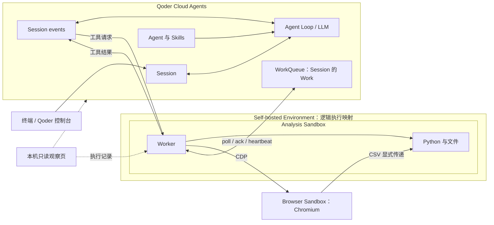

# Qoder × Agent Sandbox Live Demo

用三轮报表分析任务，观察 **Qoder Cloud Agents 如何决策、阿里云 Agent Sandbox 极速版如何执行工具**：浏览器下载 CSV，Python 分析，再连续追问和追加记录。默认使用合成数据；结果由程序读取真实文件独立核算。

Qoder 托管 Agent Loop、模型、Session 和 WorkQueue。Analysis Sandbox 运行 Worker 与 Python，Worker 控制另一套 Browser Sandbox。终端或 Qoder 控制台发送消息；本机 Web 只观察执行，可切换明暗主题。

## 开始前

准备 Python 3.11+、已启动的 Docker 与 Buildx，以及阿里云 AK/SK、地域和独立的 Qoder 国际站 PAT。临时阿里云凭证还需 STS Token。默认连接杭州 Agent Sandbox；Team API Key 必须属于对应 Team，不能使用 E2B Cloud Key。

向导优先查询和复用 Team、ACR 企业版与兼容网络；新建、修改访问配置和购买前会说明影响并确认。服务开通、权限、配额及费用仍需账号满足，不能把“提供 AK/SK”理解为自动获得使用资格。ACR、Sandbox 等资源可能收费，首次镜像构建不计入现场任务演示时间。详见[账号准备](docs/bootstrap.md)和[安全说明](SECURITY.md)。

## 一条命令，六个阶段

在项目根目录运行：

```bash
./start.sh
```

先看步骤可用 `./start.sh --preview`，只看帮助可用 `./start.sh --help`，两者都不创建资源。向导自动使用 `.venv`，无需先激活。

1. **准备本机。** 检查 Python，安装本仓库及演示、构建依赖。看到“命令已可用”后继续。活动条显示实际安装阶段与耗时，完整输出在 `var/logs/install.log`。
2. **连接账号与基础资源。** 填写授权，选择复用或新建 Team、仓库与网络，保存配置和资源归属。输入 `?` 查看字段来源，输入 `open` 打开配置页面；已有凭证只提示已配置，回车保留。
3. **准备两套模板。** 核对云端状态、镜像和源码；就绪且匹配则复用，否则构建并等待 `ready`。终端显示 Browser、Analysis 的 Template ID。公网推送成功还不代表平台能够通过 VPC 拉取镜像。
4. **连接运行现场。** 创建或接续 Qoder Agent、Skill、Environment、Session、两个 Sandbox 和 Worker。看到会话地址、两个实例 ID 及预览就绪提示。观察页展示云端决策、队列、会话事件与执行位置；Qoder 会话入口用于发消息。
5. **运行三轮引导。** 每轮先在终端显示完整消息和预期动作，再显示工具调度、实际数字及验收结论。选择向导发送，或在 Qoder 发送后由终端观察；同轮二选一。默认结果依次为 **100 条 / 45,392.18 → 65 条 / 28,508.77 → 101 条 / 52,058.18**，全部通过后输出 `LIVE_PASS`。已提交或验收的轮次不会重复发送。
6. **验收与收尾。** 查看已通过的三轮快照，选择继续对话、查看执行、保留环境或回收。本地结果在 `var/results/<run_id>/`；后续自由对话不套用三轮固定行数验收。

阶段切换保留前序输出，活动条只更新当前行。回车和输错选项不会退出；涉及云端变更仍需输入指定确认词，未批准就继续等待。报错后保留现场，不跳过检查或自动重试；查看关键错误和 `var/logs/`，修正后按 `Ctrl+C` 退出再重跑。`Ctrl+C` 只关闭本次启动的预览，保留配置与云端记录。已有未回收运行时，先继续或回收，避免覆盖其配置。运行仍可用、源码版本匹配且三轮均已验收时，选择 `continue` 会恢复观察页并直接进入收尾菜单；未完成的轮次仍按进度接续。模板提交后应等返回 ID；返回前被强制中断，应先在控制台核对，避免重复创建。

调试面板按输入聚合模型与工具操作，提供执行树、时间线及输入输出、执行详情、原始记录；新运行记录安全的 API 请求/响应，旧记录缺失的耗时明确标注。页面布局与各项数据含义见[观察页说明](docs/live-observability.md)；逐条命令、配置和排障见[实操指引](docs/live-demo.md)。

## 三轮之后，继续用同一会话

收尾菜单默认进入终端 `chat`；也可在 Qoder 控制台继续发送。观察页左侧只列当前 Session 的用户输入，用于选择要查看的调用记录。

```bash
.venv/bin/qoder-self-hosted-sandboxes-demo chat
# 只发一条并等待回复
.venv/bin/qoder-self-hosted-sandboxes-demo chat --message "沿用当前 CSV，恢复全部分类，并解释计算过程。"
```

等待上一轮结束后再提交；终端输入 `/back` 返回收尾。原始消息交给 Qoder 理解和选择工具，不新增 Session 或 Sandbox。Work 租约心跳不延长 Sandbox 有效期，默认实例超时为 3600 秒。发送结果不明确时先核对会话，再用 `/retry` 或 `chat --retry` 沿用原消息编号重试；`/discard` 只清除本地重试记录，不会撤回已提交消息。

## 回收与保留

收尾输入 `cleanup`，或执行：

```bash
.venv/bin/qoder-self-hosted-sandboxes-demo cleanup
```

成功输出 `cleanup_pass`：停止本轮工作、释放两个 Sandbox、归档本轮 Session/Agent/Environment、删除本轮 Skill。模板、ACR 镜像、本地配置与结果保留。输入 `keep` 后仍可查看或回收；回收完成后向导也会保留终端反馈，由 `Ctrl+C` 结束。保留的云端运行之后仍需回收。

如需进一步卸载向导创建的准备资源，先完成上面的回收，再执行：

```bash
.venv/bin/python scripts/bootstrap.py --uninstall
```

卸载按归属记录处理，复用资源保留；归属不明的模板不会自动删除。购买的 ACR、默认 OSS 与共享服务角色不自动退订或删除，仍需核对保留项及费用。不要先删除 `var/state/`。实例没有挂载 Volume，释放或到期后不承诺保留文件和进程；需要的远端产物应先另行保存。

## 架构：谁决策，谁执行



Work 按 Session 承接，具体创建触发点不作推断；每次工具调用通过 Session events 传递。Skill 内容通过 `Read` 返回给云端模型，指导后续决策；Worker 执行工具，不运行第二套模型循环。队列和实例信息读取失败时显示不可用；`workers_polling` 表示最近 30 秒轮询者数量，不是在线 Worker 数。详见[架构与 API 链路](docs/architecture.md)。

工具参数、结果及部分数据会回传 Qoder，不能宣称数据全部留在自托管环境。Browser 操作针对固定合成数据页，本例不验证任意网站浏览、持久卷或进程恢复。本地检查与真实云端验收需分别记录，历史记录不代表当前版本已经通过。

## 代码入口

```text
start.sh                          六阶段入口
scripts/                          账号准备、模板预检、终端反馈
config/                           连接、Agent、模板、三轮消息与超时
src/qoder_self_hosted_sandboxes_demo/
  qoder/                          Agent / Session / Environment / Skill API
  environments/self_hosted/       Worker：领取、租约、事件、执行与回传
  sandbox/                        实例与模板构建
  demos/report_analyst/            任务、终端对话、观察页、工具与独立验收
skills/report-analysis/SKILL.md    Agent 读取的工作方法
images/report_analyst/             Analysis 自定义镜像
tests/                            本地回归
docs/                             操作、架构、验证与安全边界
var/state/                        本轮资源、模板归属与任务进度
var/results/<run_id>/              事件、验收记录与部分产物
```

`config/agent.toml` 配置模型、指令和 Skill；`config/demo.toml` 保存三轮消息。业务工具通过 `tool_provider="模块:工厂函数"` 注入；通用 Worker 与报表业务分开，基础工具支持 Bash、Read、Write、Edit。

独立使用 Worker 时，填写已有 Environment、Session 与工作目录，通过环境变量提供 `QODER_ACCESS_TOKEN`：

```bash
python -m pip install -e .
cp -n config/worker.example.json config/worker.json
qoder-self-hosted-sandboxes-demo worker --config config/worker.json
```

Worker 专用于一个 Session，不直接执行 Environment 的 Setup script。仓库外运行时设置 `QODER_SANDBOX_HOME` 指向项目目录。开发检查运行 `python -m unittest discover -s tests -v`；可选的页面交互检查见 [tests/observer-ui.cjs](tests/observer-ui.cjs)，需先准备 jsdom。本地通过不代替云端接入验证。

许可证见 [LICENSE](LICENSE)，第三方图标说明见 [NOTICE](src/qoder_self_hosted_sandboxes_demo/demos/report_analyst/web/icons/NOTICE.md)，提交规范见 [CONTRIBUTING.md](CONTRIBUTING.md)。
