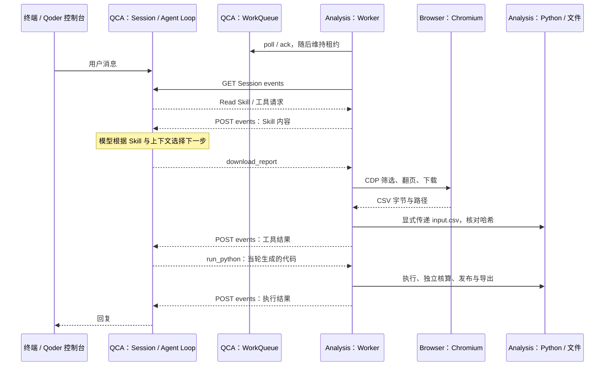

# 架构、协议与执行边界

Qoder Cloud Agents（QCA）托管 Agent Loop、模型推理、Session 和 WorkQueue。Self-hosted Environment 是 Session 到外部执行端的配置与逻辑映射。本例在 Analysis Sandbox 运行 Worker 和 Python，在独立 Browser Sandbox 运行 Chromium；本机提供准备、对话、观察与独立验收。

## 一次任务如何完成



图中 Work 管理与用户消息不表示固定的先后依赖。Work 按 Session 承接，精确创建触发点未在本例中确认；工具调用通过 Session events 传递，不为每次调用重新领取 Work。WorkQueue 和 Session events 都属于 QCA 云端。

Worker 不运行第二套模型循环。Skill 是方法和约定：`Read` 将其内容返回给云端模型，模型再决定工具调用；Skill 文件本身不执行浏览器或 Python。

## API 与代码入口

Worker 的 Work 路径以 `/environments/{environment_id}/work` 为前缀：`GET /poll` 领取，`POST /{work_id}/ack` 确认，`POST /{work_id}/heartbeat` 续约，`POST /{work_id}/stop` 停止。租约与 Session 事件是两条通道。

`demos/report_analyst/observation.py` 通过 `GET /environments/{environment_id}/work/stats` 读取真实队列统计；已知 Work ID 时，再读取 `GET /environments/{environment_id}/work/{work_id}` 并核对其 Session 归属。

```text
GET  /sessions/{session_id}/events   读取消息、状态、工具请求与结果
POST /sessions/{session_id}/events   发送用户消息或回传工具结果
```

代码按职责拆开：

- `qoder/client.py`：HTTP 请求、事件分页与消息发送；`qoder/agents.py`、`sessions.py`、`environments.py`、`skills.py`：对应资源操作。
- `environments/self_hosted/worker.py`：Work 领取、租约、Session 事件、权限与结果回传；不加载报表页面或分析库。
- `demos/report_analyst/cli.py`：创建两套实例、核对镜像、上传并核对 Skill、创建 Qoder 资源、启动 Worker、清理。
- `session.py`、`verification.py`：三轮任务与真实文件验收；`conversation.py`、`live_session.py`：终端自由对话、公开事件观察及提交去重。
- `worker_tools.py`、`browser_tools.py`、`analysis_tools.py`：注入业务工具，分别操作 Browser 和执行 Python；`preview.py`、`execution.py`：只读页面与脱敏执行记录。

业务文件路径均相对 `src/qoder_self_hosted_sandboxes_demo/demos/report_analyst/`。页面数据范围和失败显示规则以[观察页规范](live-observability.md)为准。

## 环境、模板与文件

Browser 使用官方 Chromium 镜像；Analysis 自定义镜像包含 Worker、Python 依赖和数据服务。`config/templates.toml` 固定镜像、规格、启动与就绪命令。创建实例后核对镜像中的源码和服务，不临时覆盖旧镜像来冒充验证通过。

Worker 通过 CDP 控制远端 Browser。Browser 访问 Analysis 的合成数据页；下载后通过 E2B 文件 API 显式传递 CSV，记录两端 SHA-256。`run_python` 执行 Agent 当轮生成的代码，`publish_dashboard` 独立核算后发布，`export_artifacts` 生成 CSV、Excel、JSON 与离线 HTML。文件存在于执行环境中，不构成 Web 报表或下载入口。

`config/registry.toml` 的 VPC 参数用于平台从 ACR 拉取镜像，不配置运行实例的 VPC。Environment 的 Setup script 不等同于 Worker 接入协议，本例不靠它部署 Worker。

## 状态与责任边界

队列统计读取真实接口；`workers_polling` 表示最近 30 秒轮询者，不代表在线 Worker 或真实可用容量。接口失败显示不可用，不通过消息数或动画补算。已保存的实例身份与实时查询状态分开呈现。

Worker 按工具调用 ID 缓存结果，回传重试不会再次执行已完成工具；这不承诺任意崩溃点下所有外部副作用都只发生一次。默认工具限制工作目录并清理子进程凭证，但不构成同实例内完整的进程安全隔离。

本机预览只绑定回环地址，不向页面暴露云端令牌。工具参数、执行结果及部分数据会传回 Qoder。没有挂载 Volume，实例释放或到期后不承诺文件、进程或任务恢复；需要保留的产物应事先另行保存。

概念背景可参见 [Qoder 资源说明](https://docs.qoder.com/cloud-agents/overview)与 [Environment 说明](https://docs.qoder.com/cloud-agents/environments)；本仓库的具体边界以代码和当次验证为准。

## 执行轨迹实现

`qoder/telemetry.py` 采集并安全投影显式启用的 QCA HTTP 尝试；`lifecycle.py` 记录资源事实与 SDK 创建耗时；`tracing.py` 将这些事实和已有会话/Worker 记录关联成只读操作树。`observation.py` 组织页面数据，`preview.py` 合并控制端与 Worker 采集，并限制单消息回放范围。前端 `web/live.js` 消费同一轨迹模型，提供输入输出、执行详情、原始记录三个标签；不从动画、时间相邻或当前活动消息推断隐藏的执行关系。
