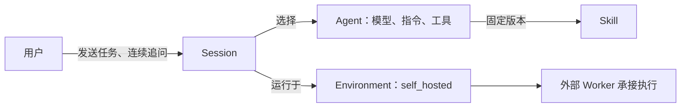
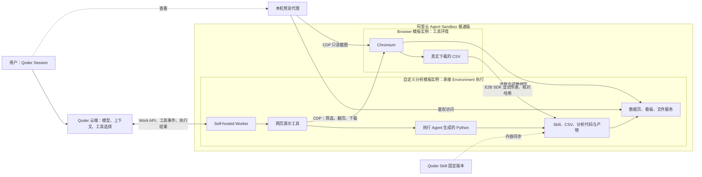
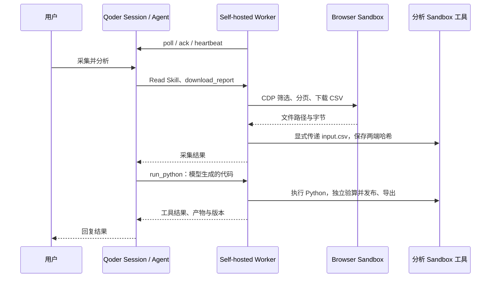

# 架构、流程与执行边界

## Qoder 资源关系

Qoder 控制台的 Environment 定义 Agent 任务在哪里运行。Session 绑定 Agent 和 Environment，Agent 绑定 Skill。Environment 是可复用配置，具体运行任务、上下文与事件属于 Session。[官方资源概念](https://docs.qoder.com/cloud-agents/overview)、[Environment 定义](https://docs.qoder.com/cloud-agents/environments)。

本例不新增名为 Runtime 的资源或目录。Worker 是 Self-hosted Environment 的执行端实现，Agent Loop 是 Qoder 提供的决策循环，两者职责不同。

## 实际部署

这张图描述实际接入链路。Qoder 官方说明 Self-hosted 使用外部 Worker 执行工具，模型推理仍在云端；不能从“Agent 运行于 Environment”推导模型、调度与整个 Agent Loop 都位于同一 Sandbox。[Self-hosted 说明](https://docs.qoder.com/release-notes/cloud-agents)。

Self-hosted Environment 不启动 Qoder 托管容器。本例创建分析 Sandbox 并启动 Worker，再通过 poll、ack、heartbeat、stop 协议承接指定 Session。Environment 中的 Setup script 是初始化配置，不等同于 Self-hosted 接入协议；本例不依赖该脚本部署 Worker。[官方 Environment 文档](https://docs.qoder.com/cloud-agents/environments)。

## 模块关系

- `qoder/`：按 Agents、Sessions、Environments、Skills 拆分 API 操作；不创建 Sandbox，不加载网页演示。
- `environments/self_hosted/`：实现工作租约、事件处理和工具回传；默认使用基础工具，通过配置注入扩展。
- `sandbox/`：封装 E2B 实例操作与阿里云模板构建；不承担 Agent 推理。
- `skills/`：Agent 读取的工作方法和交付约定，不是工具执行代码。
- `demos/report_analyst/`：组合以上模块，定义演示工具、场景、页面与验收；可换成其他工具提供器。
- `config/`：所有人工连接、Agent、Environment、模板、ACR 和演示参数；`var/` 只存生成记录。

Agent 配置位于 `config/agent.toml`。真正的“模型决定下一步 → 工具执行 → 观察结果 → 继续或结束”由 Qoder 运行；仓库中的 `worker.py` 只完成其中工具执行与结果回传。

## 创建与任务流程

1. `qoder-self-hosted-sandboxes-demo templates` 构建 Browser 模板和自定义分析模板；启动命令与就绪检查在模板中固化。
2. `qoder-self-hosted-sandboxes-demo setup` 创建两个 Sandbox，核对自定义镜像源码和已启动服务。
3. 上传 Skill，下载固定版本并逐字节核对，在分析实例放置同一内容。
4. 创建 Agent、Self-hosted Environment 和 Session，记录各自 ID。
5. 在分析实例启动 Worker，指定 Environment ID、Session ID 与工具提供器。
6. 用户在 Session 发任务；Qoder 调用 `Read` 读取 Skill，产生自定义工具事件。
7. Worker 核对租约、Session、待执行事件与权限，执行工具并按工具调用 ID 保存及回传结果。
8. Qoder 根据结果继续调用工具或结束回复；本地验收读取真实文件独立核算。

三轮任务依次完成采集分析、排除最高分类、追加一条记录。追问复用同一 Session、两个实例和已下载文件；不是从头重建环境。

## 工具与模板

- `download_report`：固定页面自动化，真实操作 Chromium、筛选、分页、下载，通过 E2B 文件 API传递 CSV。
- `run_python`：执行 Agent 当轮生成的 Python；不是预置统计答案。
- `publish_dashboard`：独立核对 CSV 的行数、分类、地区、日期与金额后发布新版本。
- `append_record`：追加一条记录，保留前后行数和哈希；同一工具调用的结果重传由 Worker 缓存处理。
- `export_artifacts`：生成真实 CSV、Excel、JSON 和内嵌 Plotly 的离线 HTML。

Browser 使用官方镜像与启动服务；分析镜像固化 Worker、依赖与网页服务。原版 E2B SDK 用于实例创建、连接、命令与文件操作；ACR 自定义模板构建使用阿里云原生 API。

`config/registry.toml` 的 VPC 参数仅用于 `registry_config.network_config` 镜像拉取。它不配置运行实例的 VPC 访问；实例控制台相应字段可以为空。

## 证据与限制

Worker 按工具调用 ID 缓存结果，回传重试不重新执行工具；未实现任意时刻崩溃后全部外部副作用的 exactly-once。默认基础执行器限制工作目录并清理子进程凭证，但不构成同一实例内进程间的完整安全隔离。

网页与图表数据服务在分析实例。本机代理只绑定回环地址，添加访问令牌并修正云端网关给 HTML 加的附件响应头。页面不包含云端访问令牌；Browser 实时画面是 CDP 截图。Browser 内也有固定上游的回环代理，用于访问实际分析实例数据页。

没有挂载 Volume；文件暂存于实例，删除或到期后不承诺保留。需要保留的产物应下载。工具参数、执行结果及部分数据会传回 Qoder，不能宣称所有数据都不离开自托管环境。
