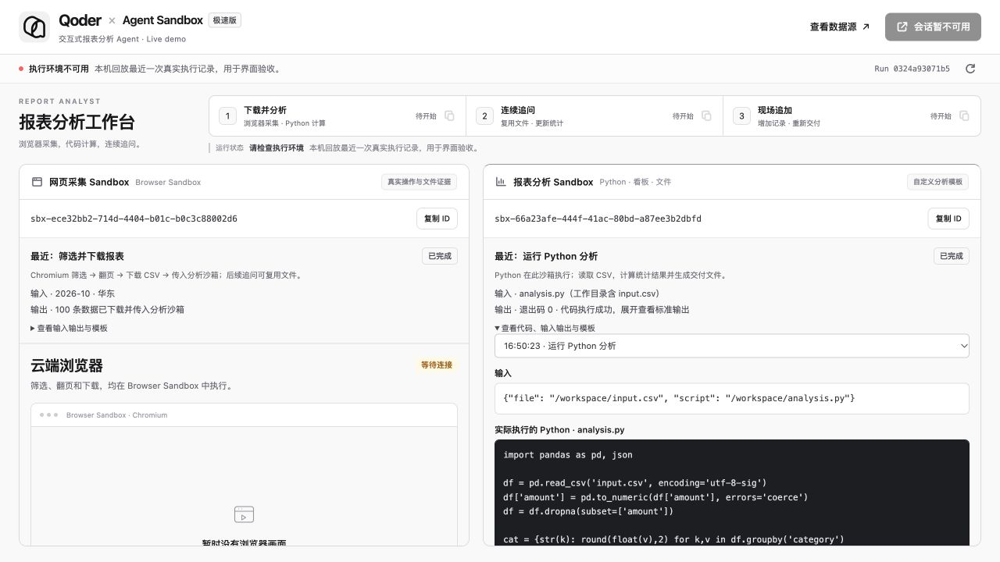
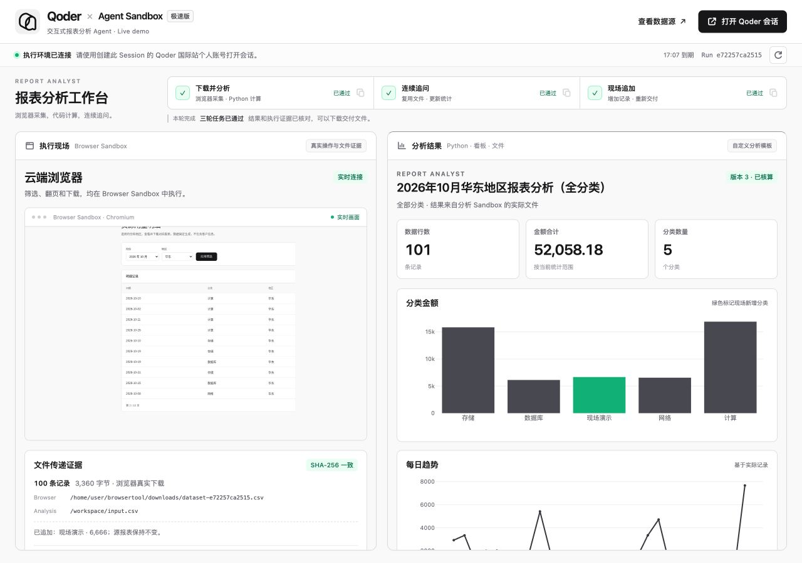
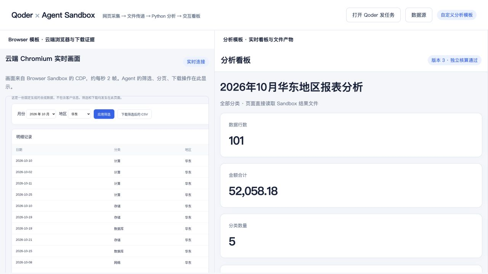
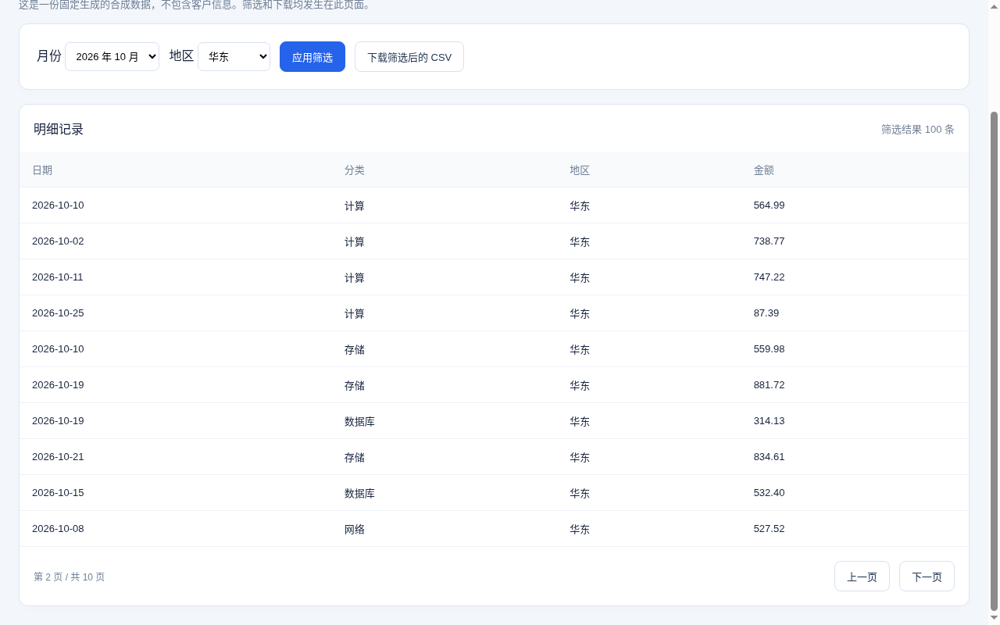

# 真实服务验证记录

## 终端向导与执行过程展示：2026-10-29

六阶段统一呈现目的、路径、预期产物与实际完成反馈；第 2 阶段接入合并后的 AK/SK 自动准备，并细分为授权、Team/Key、ACR、镜像拉取网络和仓库。显式选择、新建/购买授权及归属保护保持不变。安装、模板构建和创建过程默认收起详细日志；错误显示原因与私密日志位置。新增 `./start.sh --preview`，无需依赖或凭证即可查看步骤，无文件及云端变更。

前端显示两个完整 Sandbox ID 与复制入口，按真实 Worker 工具记录展示状态、代码和输入输出，可切换动作历史。网页采集工具归属 Browser 实际执行，并明确由 Analysis Worker 发起与传递文件；通用命令、其他 Session 记录和凭证不作为原始日志返回。新增模板分别使用 `qoder-sandbox-csv-browser-<时间戳>` 和 `qoder-sandbox-py-analysis-<时间戳>`，配置与实例中记录真实镜像和模板名称；旧运行缺失的信息不猜测补齐。

当前 **108 项本地测试通过**，覆盖真实 HTTP 执行记录接口、运行中/完成/失败投影、脱敏和 Session 过滤、只读向导预览、真实子进程进度与中断回收，以及合入后的资源准备与运行回归。网页使用保存的真实三轮工具记录进行本机回放验收，验证展开代码与复制 ID；未新建云资源或执行购买，未把本机回放标为新的云端端到端验收。用户当前运行和基础资源保留。



## 镜像推送断连恢复：2026-10-29

修复 `docker push` 遇到 `write: broken pipe` 后直接退出的问题：推送同一镜像最多尝试 3 次，重试间隔 2 秒、5 秒；只重试已识别的网络/临时服务错误。登录、权限、证书与未知错误直接停止。推送成功前不提交分析模板创建请求，失败保留配置和运行记录，提示检查网络并重跑；临时上传签名 URL 的查询参数不输出。

**76/76 本地测试通过**，新增 4 项使用真实 CLI 子进程验证首次成功、断连后成功、重试耗尽以及权限/证书/未知错误停止。修复后的真实 ACR 镜像推送成功，分析模板 `cv4tfah6t5esxcljfdcy` 已核对云端 ready、镜像与当前源码一致。本轮保留用户正在进行的配置与模板准备进度，供继续向导。

## Stage 3 修复与界面更新：2026-10-29

- 修复 ACR 原生 SDK 签名参数类型：分页等参数先经官方 `Utils.query` 转为字符串，再签名请求。本地真实 HTTP 与云端仓库创建均通过，重跑可复用已有仓库。
- 本地 **72/72 测试通过**，覆盖真实子进程、配置读写、本机 HTTP、会话到期、当前版本导出门禁及源码变更后的恢复行为。Mac 默认 Bash 的语法与帮助入口通过。
- 安装显示真实 pip 阶段与活动条，失败保留完整日志；配置字段提供示例、来源说明和官方页面跳转，密钥隐藏输入。
- 使用 [Qoder 官网原始图标](https://qoder.com/favIcon.svg)，保留原始 SVG 字节。界面按当前任务、浏览器现场、分析结果组织；宽屏双栏，窄屏页签默认展示分析结果与实时概况。
- 已在浏览器核对当前窄屏首屏、两类视图切换及结束状态：会话、任务复制与下载入口均暂停；图表重排正常。当前版本未完成导出时，下载接口返回 409，页面提示等待并保留分析视图。
- 构建、向导恢复和运行记录使用同一源码摘要，包含 JS/SVG；修改源码后不继续使用旧运行，提示回收并重建。

### 本轮真实回归

同一 Session 与两个 Sandbox 完成三轮：首次分析 **100 行 / 45,392.18 / v1**（23 项检查）；连续追问 **65 行 / 28,508.77 / v2**（22 项）；追加记录 **101 行 / 52,058.18 / v3**（26 项）。三轮均通过，下载修正后再次验收第三轮通过。

桌面浏览器实际核对宽屏双栏、窄屏页签、云端 Chromium 画面、实例与文件证据。内嵌看板曾显示下载成功但未落盘，已改由主页面创建下载链接；修正已同步至本轮实例实测，并重新构建最终模板、核对云端 ready 与源码摘要一致。浏览器下载的 Excel 与独立验收文件逐字节一致：8,496 字节、101 条记录，SHA-256 为 `435cc14f6aadc514f001ae13c421e707e44145afeeecf292dc87317aa512d595`。



[窄屏实测效果](images/preview-onboarding-narrow.jpg)。回收后再次核对会话、任务复制和下载均已禁用。

本轮清理复查：Qoder Session、Agent、Environment 无活跃资源，Skill 已删除；Sandbox 列表为空；5 个本 Demo 模板（含中间构建）及 ACR 仓库内 4 个镜像标签已删除，仅保留原有官方模板。两个本机预览端口已释放，本地运行状态、4 个专属镜像标签和测试下载已清除。凭证、配置、虚拟环境、ACR 实例/命名空间和网络保留。

## 启动向导增量验证：2026-10-29

已增加 `./start.sh` 六阶段交互入口、配置与恢复支撑工具，并在构建记录中保存模板参数快照。

- 完整本地回归 **53/53 通过**，其中 22 项覆盖向导配置、进度与预览识别，4 项覆盖启动脚本。
- 验证了隐藏值的正确存储、0600 权限、输入中断及后续校验失败时保留已填配置、已提交任务不重复发送。
- 验证了模板构建中与解析错误不会触发重复构建、云端省略启动字段时需匹配构建快照、确认就绪后才刷新本地元数据。
- Mac 默认 Bash 的语法与帮助入口已检查，非交互运行会在安装或创建资源前拒绝；临时配置、本机 HTTP 和全部旧有测试通过。
- 本轮未运行真人交互向导或创建云资源；项目实际 `var/` 仍为空，供用户亲自试跑。下方云端记录对应加入向导前的三轮实测。

## 最新回归：2026-10-29

本轮使用统一命令 `qoder-self-hosted-sandboxes-demo` 和最终源码，重新构建 Browser 模板与 ACR 自定义分析模板，真实连接 Qoder 国际站和阿里云杭州 Agent Sandbox。验证后已回收本 Demo 资源并清空本地运行状态。

### 回归结果

- 本地测试 **27/27 通过**，覆盖数据处理、文件和 HTTP 下载、Worker 协议、模块独立性、初始化失败重试和输入记录完整性。
- 统一入口的 17 条帮助路径、参数转发与独立 Worker 已核对；README 的 13 条命令路径、相对链接和默认统计结果已核对。
- 下载分析：**100 行、45,392.18、版本 1**，23 项检查全部通过。
- 连续追问：**65 行、28,508.77、版本 2**，22 项检查全部通过。
- 现场追加：**101 行、52,058.18、版本 3**，26 项检查全部通过，输出 `LIVE_PASS`；独立 `verify --phase append` 再验收通过。
- 三轮复用同一 Session 和两个 Sandbox；Browser 真实下载、两端 SHA-256、动态 Python、CSV/Excel/JSON/HTML 和原记录完整性均通过独立核验。
- 分析实例创建请求单次实测 **879.7 ms**，含客户端网络，不作为 SLA 或 P95。

本轮已在桌面浏览器核对双栏预览、云端 Chromium 画面和第三轮看板，并实际点击下载 Excel。下载文件与云端验收文件哈希一致，101 条记录、52,058.18 合计及新增记录逐项核对通过。



### 修正内容

- 初始化已创建部分 Qoder 资源时，拒绝覆盖原有 ID，提示先回收再重建，避免资源遗漏。
- 采集验收逐条比较下载记录；追加验收核对原记录完整保留，以及新增记录的日期、分类、地区和金额。
- Browser 构建命令不再直接返回可能失效的本地模板 ID，与分析构建一样显式创建新模板。
- README 按仓库用途、分步操作、阶段反馈、架构和代码组织重排；排障补齐配置文件优先级、实际下载路径、恢复条件及预览端口占用。

### 资源清理复核

- 本次 Qoder Session、Agent、Environment 已归档，Skill 已删除；列表复查无本 Demo 活跃资源。
- 两个 Sandbox 已释放，实例列表为空。
- 已删除 3 个本 Demo 模板，包括本轮中间构建；复查只保留原有 `code-interpreter-v1` 官方模板。
- 已删除 `sandboxhub/qoder-self-hosted-sandboxes-demo` ACR 仓库及其中 5 个镜像标签，仓库列表复查为空。
- 已停止本机预览、确认 8765 端口释放；清空项目 `var/`、测试缓存和项目专属本地镜像标签。
- 凭证、配置、Python 虚拟环境、ACR 实例与命名空间、VPC/vSwitch/安全组保留。

下次按 README 从头操作：复用已有凭证、网络和 ACR 实例，在第 2 步重新创建 Demo 私有仓库，第 3 步重新构建模板。以下旧资源编号仅作为历史证据，不可用于发起新任务。

## 前次验证：2026-10-29 11:34

验证时间：2026-10-29T11:34:31+08:00。项目：`qoder-self-hosted-sandboxes-demo`。

本轮使用最终目录、`report_analyst` 模块、`report-analysis` Skill 与最终 ACR 仓库，真实调用 Qoder 国际站和阿里云杭州 Agent Sandbox。三轮任务通过 Qoder API 发送至同一 Session。

### 三轮任务

- 下载报表并分析：**100 行，45,392.18，看板版本 1**；22 项检查全部通过。
- 追问排除最高分类：**65 行，28,508.77，看板版本 2**；22 项检查全部通过。
- 追加一条现场记录：**101 行，52,058.18，看板版本 3**；24 项检查全部通过。

### 执行与文件证据

- `analysis_mode=custom_image`；实例创建后服务已运行，没有现场安装依赖或补启动。
- 镜像中的 Worker、工具与网页源码逐文件核对通过。
- 分析服务鉴权：匿名 403，携带访问令牌 200。
- 本次分析实例创建请求耗时 **1219.6 ms**；这是单次客户端测量，包含网络和请求处理。
- Browser 下载路径：`/home/user/browsertool/downloads/dataset-68231fc75f2d.csv`。
- Analysis 输入路径：`/workspace/input.csv`。
- 两端下载文件 SHA-256：`73941f82e76d171407efb2c6c4fffb1f46db5dc4717ecdc5ea506ca4d5912b92`。
- 追加后输入 SHA-256：`759afbc5c85c128cf7b570acdae4dc26a180d7edf8da69c66844000e72d482e7`。
- 追问轮输入哈希不变；追加轮仅增加一条 6,666 记录；原始合成数据源不变。
- Excel 按内容读取核算行数和金额；CSV 逐行比较；JSON 比较当前看板；四类文件逐一核对字节数和 SHA-256；离线 HTML 内嵌 Plotly。

- `data.csv`：3,400 字节，SHA-256 `759afbc5c85c128cf7b570acdae4dc26a180d7edf8da69c66844000e72d482e7`。
- `analysis.xlsx`：8,495 字节，SHA-256 `a1e95c4371a87be356ac1f97015d16154bf6e285605080fb59b984d4bcbe3582`。
- `analysis.json`：1,711 字节，SHA-256 `6ecb530b5e61a701f81b082cc4f6bf7aa72b2c5181e0de1c68567a959914b4c2`。
- `report.html`：4,838,719 字节，SHA-256 `a86007c673c47efdf9c204d111ecd70c6e3bd6a58b8e775bc31bd15ef52e66fe`。

### 本轮资源

- [Qoder Session](https://qoder.com/cloud/sessions/sess_00tuk2utcivi8ar0i2kt)。
- Agent：`agent_00tuk2tzdpbls75wl785`，名称 `报表分析Agent-68231fc75f2d`。
- Self-hosted Environment：`env_00tuk2udlp24hrpudscq`。
- Skill：`skill_00tuk2syyosg1cuv3ckj`，版本 `1793244704832721`。
- Analysis 实例：`sbx-b04c9638-b3dc-4799-959c-a7f33c3cae56`；模板 `yswq01mw7j5mdofn5waa`。
- Browser 实例：`sbx-ed4047c5-1abd-4aee-b49e-39e14a431e51`；模板 `v32s4qrcelice7k9m7lk`。
- ACR 镜像：`acree-registry-vpc.cn-hangzhou.cr.aliyuncs.com/sandboxhub/qoder-self-hosted-sandboxes-demo:analysis-3e723f1ea46d`。

本轮实例实际到期时间：Browser 为 2026-10-29 12:31:39 +08:00，Analysis 为 12:31:41 +08:00。复现时以自己的 `qoder-self-hosted-sandboxes-demo setup` 输出为准；删除或到期后不保证文件保留。

### 版本与测试范围

```json
{
  "python": "3.13.13",
  "e2b": "2.35.0",
  "playwright": "1.55.0",
  "pandas": "2.3.3",
  "plotly": "6.3.1",
  "openpyxl": "3.1.5"
}
```

21 项本地测试通过，覆盖真实文件、子进程、HTTP 下载、Worker 租约/权限/中断/结果重传，以及独立导入和命令入口。安装包和三个命令入口已验证；已提供 GitHub CI 配置，未声称远端 CI 已执行。

本例验证 Self-hosted Environment 的工具执行和 Agent Use Sandbox。Agent Loop 与模型推理由 Qoder 提供；没有验证主循环整体在 Sandbox 内运行。浏览器执行针对固定合成报表页面；未验证任意网站自主浏览、持久卷或进程恢复。

本轮核对了云端页面、图表脚本、看板、证据与下载接口的真实 HTTP 响应。桌面浏览器连接不可用，未重新完成本轮本机双栏页面的人工视觉验收。下图来自本轮 Agent 工具实际操作 Chromium 后保存的截图。


